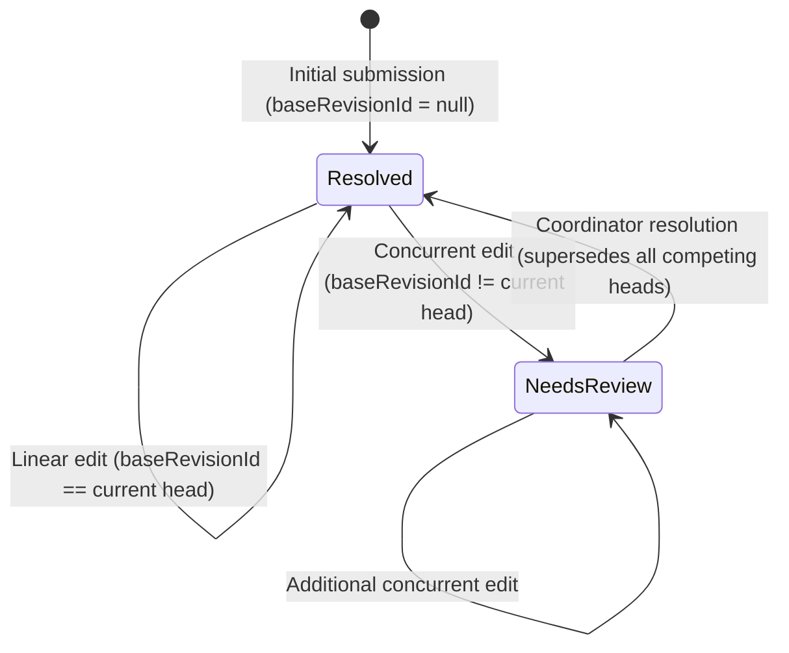

I have updated `docs/intent/record-store/record-store-design.md` around the **whole-visit revisions** model (and updated `docs/high-level-design.md`'s architecture table so `record-store` no longer lists the concurrency choice as open).

---

### Updated `docs/intent/record-store/record-store-design.md`

```markdown
---
parent: high-level-design
prefix: REC
---

# Record Store

## Context and Design Philosophy

This node owns visit persistence and the meaning of a current visit when independently edited copies arrive. A visit is identified by a client-generated UUID and refers to a catalog plot UUID. Updates can arrive days after their starting state was fetched. The server must not treat arrival order as evidence that one worker's observations are more authoritative.

Whole-visit revisions preserve each submitted visit as an indivisible scientific unit. Because field edits often carry implicit cross-field relationships—such as revising a species identification alongside its cover estimate or notes—the store never automatically combines fields across concurrent edits. Instead, edits that branch from the same starting revision become competing candidate revisions until a coordinator resolves them.

## Architecture and Revision Model

The record store exposes authenticated operations for visit submission, current-state retrieval, revision-history retrieval, unresolved-visit listing, and coordinator resolution.

Every accepted submission or resolution creates an immutable **Revision**:
- `revisionId`: server-assigned UUID uniquely identifying this revision.
- `visitId`: client-generated UUID identifying the plot visit.
- `baseRevisionId`: `null` for an initial submission or a coordinator resolution (which supersedes multiple heads), or the single `revisionId` the worker edited.
- `parentRevisionIds`: the ordered list of revision IDs directly superseded by this revision (`[]` for an initial revision, `[baseRevisionId]` for a worker edit, or the superseded head revision IDs for a coordinator resolution).
- `source`: `worker_submission` or `coordinator_resolution`.
- `authorId`: authenticated worker or coordinator identity.
- `receivedAt`: server receipt timestamp.
- `idempotencyKey`: client-supplied UUID preventing duplicate revision creation on retry.
- `payload`: structured visit fields (`plotId`, `observationDate`, `observers`, `speciesCovers`, `notes`).
- `resolutionNote`: optional coordinator explanation (present on `coordinator_resolution` revisions, `null` on `worker_submission` revisions).

For each visit, the store tracks the set of **active head revisions**—revisions that have not been superseded by a descendant revision:
- **Resolved (`status: "resolved"`)**: the visit has exactly one active head revision. That revision is the visit's current state and is eligible for Friday CSV export.
- **Needs Review (`status: "needs_review"`)**: the visit has two or more active head revisions. No single current revision exists until a coordinator resolves the competing heads, and the visit is held out of export.



## Submission Envelope and State Transitions

A worker submission request provides:
- `visitId` (UUID)
- `idempotencyKey` (UUID)
- `baseRevisionId` (UUID or `null`)
- `payload` (`plotId`, `observationDate`, `observers`, `speciesCovers`, `notes`)

Before accepting a submission, the store authenticates the worker, verifies that `plotId` resolves in `site-catalog` (both active and archived plots are valid so offline edits to recently archived plots are not lost), and validates field types.

Idempotency is evaluated before revision-graph checks:
1. **Duplicate retry**: if `idempotencyKey` matches an existing revision with an identical request body (`visitId`, `baseRevisionId`, and `payload`), the store returns the original acceptance response without storing a second revision.
2. **Key reuse mismatch**: if `idempotencyKey` matches an existing revision with a different `visitId`, `baseRevisionId`, or `payload`, the store rejects the request with `409 Conflict` (`idempotency_key_mismatch`) and leaves stored state unchanged.

When the idempotency key is new, the store validates lineage and updates the visit's active head set:
1. **Initial submission (`baseRevisionId: null`)**:
   - If the visit does not exist, the store creates the visit, stores the initial revision, and sets it as the sole active head (`status: "resolved"`).
   - If the visit already exists (for example, two tablets independently created a visit record with the same `visitId` or a client submitted without knowing the visit existed), the store accepts the submission as a competing root revision (`parentRevisionIds: []`), adds it to the active head set, and transitions the visit to `status: "needs_review"`.
2. **Linear update (`baseRevisionId` matches the sole active head)**:
   - When the visit is currently `resolved` and `baseRevisionId` equals its current `headRevisionId`, the new revision supersedes that head and becomes the new sole active head (`status: "resolved"`).
3. **Concurrent update (`baseRevisionId` is an earlier known revision of the visit, or the visit is already `needs_review`)**:
   - When `baseRevisionId` refers to any known revision of `visitId` that is not the sole active head—either an ancestor revision that has already been superseded, or one of the active heads while the visit is in `needs_review`—the store accepts the submission, adds the new revision to the active head set (superseding `baseRevisionId` if `baseRevisionId` was itself an active head), and sets the visit to `status: "needs_review"`.
4. **Invalid base revision**:
   - If `baseRevisionId` does not exist or belongs to a different `visitId`, the store rejects the submission with `422 Unprocessable Entity` (`invalid_base_revision`).

The submission response returns the created `revisionId`, `visitId`, `receivedAt`, the resulting visit `status` (`"resolved"` or `"needs_review"`), and the current `activeHeadRevisionIds` so `tablet-sync` can immediately record the new server revision ID and inform the worker whether their submission became the current state or entered review.

## Retrieval Contract

### Visit State (`GET /visits/{visitId}`)

Returns the visit's current status and revision pointers:
- `visitId`: UUID
- `status`: `"resolved"` | `"needs_review"`
- `currentRevision`: the full revision object when `status == "resolved"`, or `null` when `status == "needs_review"`.
- `competingRevisions`: empty list when `status == "resolved"`, or the full list of active head revision objects (with their `baseRevisionId`, `authorId`, `receivedAt`, and `payload`) when `status == "needs_review"`.
- `commonBaseRevision`: when `status == "needs_review"`, the most recent common ancestor revision shared by the competing heads (or `null` if competing roots share no ancestor), allowing `review-export` to highlight what each competing revision changed without reconstructing the graph client-side.

### Revision History (`GET /visits/{visitId}/revisions`)

Returns the complete immutable list of revisions for `visitId` ordered by `receivedAt` (with tie-breaking by `revisionId`), including `parentRevisionIds`, `source`, `authorId`, and `payload`. Original worker submissions remain intact and queryable even after superseded by linear edits or coordinator resolutions.

### Unresolved and Export-Ready Queries (`GET /visits?status=...`)

- `status=needs_review` returns visits with competing active heads for the coordinator queue in `review-export`.
- `status=resolved` returns visits with a single active head eligible for the Friday CSV export in `review-export`.

## Coordinator Resolution Operation

To resolve a visit in `needs_review`, a coordinator submits a resolution (`POST /visits/{visitId}/resolutions`):
- `idempotencyKey`: UUID
- `supersededRevisionIds`: the exact set of active head `revisionId`s being resolved (must contains at least two IDs and match the visit's current `activeHeadRevisionIds`).
- `payload`: the resolved visit fields (`plotId`, `observationDate`, `observers`, `speciesCovers`, `notes`)—which may equal one of the competing revisions in full or a coordinator-authored reconciliation.
- `resolutionNote` *(optional)*: coordinator explanation of how the competing revisions were reconciled.

Validation and behavior:
- If the visit is not in `needs_review`, or if `supersededRevisionIds` does not exactly match the visit's current `activeHeadRevisionIds` (for instance, a late tablet sync added another competing revision while the coordinator was reviewing), the store rejects the resolution with `409 Conflict` (`stale_review_set`) and returns the updated active head set.
- When valid, the store creates a new revision with `source: "coordinator_resolution"`, `authorId` set to the coordinator's identity, `parentRevisionIds` set to `supersededRevisionIds`, `baseRevisionId` set to `null`, and `resolutionNote` persisted on the revision. The new resolution revision replaces all `supersededRevisionIds` as the visit's sole active head, transitioning the visit to `status: "resolved"`.
- If a tablet later syncs an offline edit whose `baseRevisionId` was one of the now-superseded revisions, rule 3 (Concurrent update) applies: the late edit is preserved as a new active head alongside the coordinator's resolution revision, returning the visit to `needs_review` so the late edit is never silently lost.

## Decisions & Alternatives

| Decision | Chosen | Alternatives Considered | Rationale |
|----------|--------|------------------------|-----------|
| Concurrent visit edit policy | Whole-visit revisions with explicit `baseRevisionId` and coordinator resolution of competing heads | Field-aware three-way merge; last-write-wins by server receipt or device clock | Preserves each submitted visit as a coherent scientific observation, avoids maintaining complex per-field merge rules, and prevents silent combination of scientifically coupled edits (such as species identification and cover percentage). |
| Resolution representation | Resolution creates a new immutable revision superseding the competing head revisions | Mutating one winning revision in place; deleting losing revisions | Keeps the revision graph append-only, preserves all original worker submissions per project tenets, and gives subsequent tablet edits a single `revisionId` to reference as their base. |
| Stale resolution guard | Require `supersededRevisionIds` to match the visit's current active head set (`409 Conflict` on mismatch) | Blindly clearing all current heads when a resolution arrives | Prevents a coordinator resolution from silently swallowing a late-arriving tablet submission that landed while the coordinator had the comparison screen open. |

## Downstream Cascade Obligations

Now that whole-visit revisions are selected, two sibling nodes have downstream obligations (to be designed in their own segments after this node is approved):
- **tablet-sync**: Persist the server's `revisionId` as `baseRevisionId` when caching or updating a visit; include `baseRevisionId` in submission envelopes; handle responses where `status` becomes `"needs_review"` so workers know their edit was saved and queued for coordinator review.
- **review-export**: Query `needs_review` visits and render a revision comparison screen using `competingRevisions` and `commonBaseRevision`; submit coordinator resolutions with `supersededRevisionIds`; exclude any visit with `status == "needs_review"` from the Friday CSV export.

## Open Questions & Future Decisions

### Resolved
1. ✅ Concurrent visit edit policy: Selected whole-visit revisions over field-aware three-way merge so scientifically coupled field changes are never auto-combined without coordinator review.

### Deferred
1. None currently.

## References

- `docs/high-level-design.md`
- `docs/intent/site-catalog/site-catalog-design.md`
```

---

### Decision Doc Offer

Because the **concurrent visit edit policy** (whole-visit revisions vs. field-aware three-way merge) weighs two credible approaches against multiple criteria (scientific integrity of coupled field edits, coordinator review load, merge-rule maintenance) and directly sizes `tablet-sync` and `review-export`, a cold reader could be tempted to revisit it later:
- Would you like to record this in a standalone decision doc at `docs/intent/record-store/decisions/concurrent-visit-edits.md` (linked from the Decisions & Alternatives table), or is the table row in `record-store-design.md` sufficient?

---

### Phase 2 LLD Edge-Case Probe

Please review these edge cases surfaced against `record-store-design.md` and let me know which to bake into the LLD now vs. defer:

1. **Coordinator resolution idempotency ordering:** When a coordinator retries `POST /visits/{visitId}/resolutions` with the same `idempotencyKey` after the first call already moved the visit to `resolved`, should idempotency be evaluated *before* the `status == "needs_review"` / `stale_review_set` check (matching worker submissions: return original response on identical retry, `409 idempotency_key_mismatch` if `supersededRevisionIds`, `payload`, or `resolutionNote` differ)?
2. **Byte-identical concurrent submissions or no-op edits:** If two concurrent submissions from the same `baseRevisionId` (with different `idempotencyKey`s) carry an identical `payload`—or a submission's `payload` is unchanged from its `baseRevisionId`—should `record-store` still record both revisions and enter `needs_review`, or auto-collapse/avoid conflict when payloads are identical?
3. **Changing `plotId` across revisions of the same visit:** Is `payload.plotId` immutable once a visit is created (rejecting edits that change `plotId` for an existing `visitId`), or can a worker/coordinator reassign an existing visit to a different catalog plot UUID when correcting a mis-logged plot?
4. **Computing `commonBaseRevision` across multi-way splits or post-resolution DAGs:** When 3+ competing heads diverge at different points, or when a late offline edit branches from an ancestor prior to a coordinator resolution (making the history a DAG), should `commonBaseRevision` be the latest revision (`receivedAt`) that is an ancestor of *all* current active heads (following `parentRevisionIds`), or should `record-store` omit `commonBaseRevision` and let `review-export` use each head's direct `baseRevisionId`?
5. **Domain validation & authorization error contracts:** Should we explicitly specify `422 Unprocessable Entity` for unknown `plotId` / invalid payload fields, `404 Not Found` for unknown `visitId` on retrieval/resolution, and `403 Forbidden` if a non-coordinator calls the resolution endpoint?
6. **List endpoint schema and ordering (`GET /visits?status=...`):** Should `GET /visits?status=needs_review|resolved` return the full `Visit State` shape ordered deterministically (e.g., by latest head `receivedAt`, tie-broken by `visitId`), or a lighter summary shape?

---

**STOP — Phase 2 Review:**
1. Do you want a standalone decision doc at `docs/intent/record-store/decisions/concurrent-visit-edits.md` or just the Decisions table row?
2. How would you like to triage items 1–6 from the edge-case probe above?
3. Once we incorporate your adjustments, do you approve `record-store-design.md` to proceed to **Phase 3 (EARS spec update for `REC-*`)**?