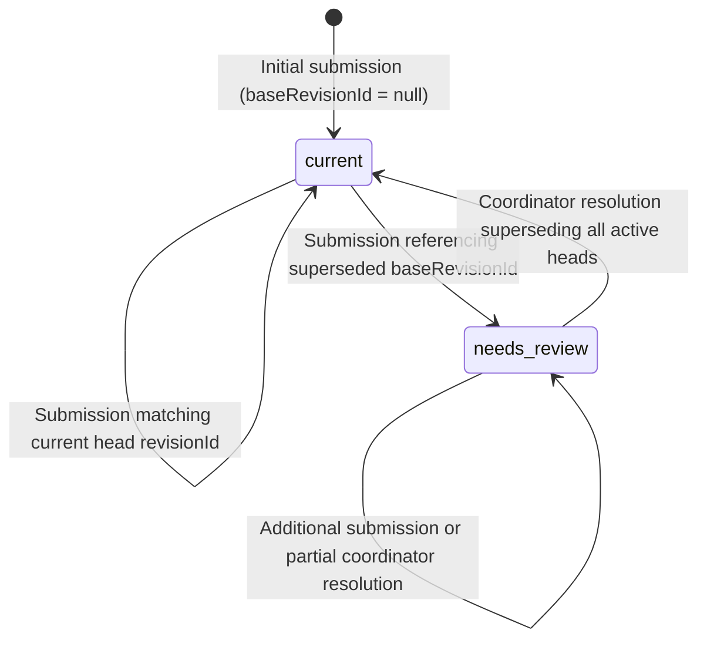

I have updated `docs/intent/record-store/record-store-design.md` around whole-visit revisions, defining the revision state model, submission envelope, current-state and unresolved-work retrieval contracts, coordinator resolution operation, downstream obligations for `tablet-sync` and `review-export`, and the `Decisions & Alternatives` table.

### Updated `docs/intent/record-store/record-store-design.md`

```markdown
---
parent: high-level-design
prefix: REC
---

# Record Store

## Context and Design Philosophy

This node owns visit persistence, revision lineage, and the definition of a current visit when independently edited copies arrive from offline tablets. A visit is identified by a client-generated UUID and refers to a catalog plot UUID from `site-catalog`. Because shared tablets can remain offline for up to 48 hours, edits can arrive days after their starting state was fetched. The server never treats arrival order as evidence that one worker's observations are more authoritative.

A visit's scientific fields—observation date, observer list, species cover estimates, and notes—can carry cross-field relationships, such as revising a species identification alongside its cover estimate or explanatory note. Because the server cannot infer those relationships from field names, the record store treats each submission as an intact whole-visit revision and routes competing edits of the same visit to coordinator review.

## Revision Lineage and Visit State

Every accepted worker submission or coordinator resolution creates an immutable whole-visit revision with a server-assigned `revisionId` and server receipt timestamp (`receivedAt`). Original submissions are retained permanently alongside the revision graph so the path from every submitted observation to the current visit state remains inspectable.

A visit is always in one of two states:

- **`current`**: The visit has a single active head revision representing its settled state.
- **`needs_review`**: Two or more competing head revisions exist for the visit, awaiting coordinator resolution.

State transitions follow base-revision lineage:

1. **Initial creation (`baseRevisionId: null`)**: When no record exists for `visitId`, an accepted submission creates the initial revision and sets the visit to `current` with that revision as its sole head.
2. **Linear update**: When the visit is `current` and an accepted submission's `baseRevisionId` matches the current head `revisionId`, the new revision supersedes the prior head and becomes the visit's new `current` head revision.
3. **Concurrent or branching edit**: When an accepted submission's `baseRevisionId` refers to an ancestor revision that has already been superseded—or when the visit is already in `needs_review`—the new revision is recorded as an additional active head revision and the visit state becomes (or remains) `needs_review`.
4. **Coordinator resolution**: A coordinator resolves a set of competing head revisions by recording a new whole-visit revision that supersedes the resolved heads. When the resolution supersedes all active head revisions for the visit, the visit transitions to `current`. If an additional worker submission arrived concurrently and was not part of the resolved set, the resolution supersedes only the named heads and the visit remains in `needs_review` with the newly created resolution revision and the unaddressed head revision.



## Operations and Contracts

### Visit Submission

Accepts an authenticated worker submission containing:

- `idempotencyKey`: client-generated key scoped to retry protection for a single logical submission
- `visitId`: client-generated UUID identifying the visit
- `baseRevisionId`: `revisionId` the edit started from, or `null` when creating a new visit
- `payload`: complete whole-visit observation data (`plotId`, `observationDate`, `observers`, `speciesCoverEstimates`, `notes`)

Before accepting a submission, the record store authenticates the submitting worker, validates field types and structural constraints, verifies that `plotId` resolves to a known plot UUID in `site-catalog` (active or archived), and verifies that a non-null `baseRevisionId` belongs to `visitId`.

The original submission payload is stored immutably with its server-assigned `submissionId`, `visitId`, `authorId`, `baseRevisionId`, and `receivedAt` timestamp. Repeating an accepted `idempotencyKey` with an identical submission envelope (`visitId`, `baseRevisionId`, and `payload`) returns the original acceptance response without storing a duplicate submission or revision. Reusing an accepted `idempotencyKey` with a different `visitId`, `baseRevisionId`, or `payload` is rejected and leaves stored records unchanged.

The acceptance response returns `submissionId`, `revisionId`, `receivedAt`, the visit's resulting `status` (`current` or `needs_review`), and the list of active head `revisionId`s.

### Current-State Retrieval

Returns the current state of one or more visits:

- `visitId`: visit UUID
- `status`: `current` or `needs_review`
- `currentRevision`: when `status` is `current`, the single active head revision (`revisionId`, `submissionId`, `authorId` or `coordinatorId`, `baseRevisionId`, `receivedAt`, and complete `payload`); when `status` is `needs_review`, `null` so callers cannot mistake an unresolved visit for a settled record
- `headRevisionIds`: the active head `revisionId`s for the visit

### Unresolved-Work Retrieval

Returns visits in `needs_review` for coordinator action and tablet conflict display. Each unresolved visit entry includes:

- `visitId` and `plotId`
- `competingRevisions`: the full set of active head revisions, each with `revisionId`, `submissionId`, `authorId` (or `coordinatorId` if a prior partial resolution is among the heads), `receivedAt`, `baseRevisionId`, and complete `payload`
- `baseRevisions`: the full revision record(s) referenced by the competing heads' `baseRevisionId` fields, enabling comparison against the starting state each worker edited

### Coordinator Resolution

Accepts an authenticated coordinator resolution containing:

- `visitId`: visit UUID
- `resolvedRevisionIds`: the active head `revisionId`s (two or more) that the coordinator compared and is resolving
- `payload`: the complete whole-visit observation data selected or authored by the coordinator to supersede those competing revisions

The store verifies that every ID in `resolvedRevisionIds` is a currently active head revision for `visitId`. It records the resolution with a new `revisionId`, the `coordinatorId`, `receivedAt`, `resolvedRevisionIds`, and the contributing `submissionId`s from the resolved revisions' lineage, then replaces `resolvedRevisionIds` in the visit's active head set with the new revision.

### Submission-History Retrieval

Returns the complete immutable lineage for a `visitId`: every worker submission and coordinator resolution, including `submissionId`, `revisionId`, `authorId` or `coordinatorId`, `receivedAt`, `baseRevisionId` or `resolvedRevisionIds`, and full `payload`.

## Downstream Contract Obligations

- **`tablet-sync`**: Must retain the `revisionId` of the last fetched visit revision and submit it as `baseRevisionId` when sending local edits; generate and persist a stable `idempotencyKey` per pending submission across network retries; and surface `needs_review` status along with competing revisions when a visit has unresolved concurrent edits.
- **`review-export`**: Must present competing whole-visit revisions alongside their referenced `baseRevisions` in a coordinator comparison view, invoke the coordinator resolution operation with the compared `revisionId`s, and hold any visit with `status: needs_review` out of the Friday partner CSV export.

## Decisions & Alternatives

| Decision | Chosen | Alternatives Considered | Rationale |
|----------|--------|------------------------|-----------|
| Concurrent visit edit reconciliation | Whole-visit revisions with coordinator resolution of competing heads | Field-aware three-way merge (automatically combine disjoint edits across scalar fields, observer lists, and species entries; route only overlapping field edits to review) | Field edits within a visit can be scientifically coupled across fields (such as changing a species identification together with its cover estimate and note). Keeping each submission as an intact whole-visit revision prevents automated merge rules from silently combining scientifically incompatible edits and avoids maintaining per-field merge heuristics, trading a larger coordinator review queue for scientific integrity and operational simplicity. |
| Submission retry protection | Client-supplied idempotency key with strict envelope matching | Server-side payload hashing without explicit keys; last-write-wins overwrite on key reuse | Offline tablets retry over intermittent connections; an explicit key distinguishes network retries from intentional re-submissions of identical values while rejecting accidental key reuse across different payloads. |

## Open Questions & Future Decisions

### Deferred
1. Whether `plotId` is immutable after a visit's initial submission or can be reassigned in subsequent revisions.
2. Whether a `baseRevisionId: null` submission for an already-existing `visitId` is rejected as a collision or recorded as a competing rootless revision.
3. Whether coordinator resolution carries its own `idempotencyKey` and rejects stale `resolvedRevisionIds` when two coordinators submit overlapping resolutions concurrently.

## References

- `docs/high-level-design.md`
- `docs/intent/site-catalog/site-catalog-design.md`
- `docs/intent/record-store/record-store-specs.md`
```

---

### 1. Decision Recording: Standalone Decision Doc vs. Table Row

Because whole-visit revisions vs. field-aware three-way merge trades credible options across multiple criteria (cross-field scientific integrity, coordinator review volume, merge-rule maintenance, and submission size) and sizes both `tablet-sync` and `review-export`, a future cold reader seeing disjoint field edits sent to manual review might be tempted to revisit it.

- **Option A**: Keep it strictly as the row in `record-store-design.md` under `## Decisions & Alternatives` (current state).
- **Option B**: Also write a standalone decision doc at `docs/intent/record-store/decisions/concurrent-visit-reconciliation.md` (owned by `record-store`, since the decision's substance lives here and cascades obligations to `tablet-sync` and `review-export`) and link it from the `Decisions & Alternatives` row.

Which do you prefer?

---

### 2. Phase 2 LLD Edge-Case Probe (Triage: Fix in LLD Now vs. Defer)

Please let me know which of these internal `record-store` edge cases you want specified in the LLD now versus left deferred:

1. **Duplicate `baseRevisionId: null` for an existing `visitId`**: When a submission arrives with `baseRevisionId: null` for a `visitId` that already exists (and is not an `idempotencyKey` replay of the initial submission), should `record-store`:
   - **(a)** reject it as a UUID collision / invalid base revision, or
   - **(b)** accept it as a competing rootless head revision and transition the visit to `needs_review`?
2. **`plotId` mutability across revisions**: Can a subsequent submission or coordinator resolution change a visit's `plotId` (e.g., if a worker selected the wrong plot in the field), or is `plotId` immutable once a `visitId` is created? (If mutable, what should top-level `plotId` in `Unresolved-Work Retrieval` report when competing heads disagree?)
3. **Concurrent / retried coordinator resolutions**: Should `Coordinator Resolution` also require an `idempotencyKey` for retry safety, and if two coordinators submit resolutions referencing overlapping `resolvedRevisionIds`, should the second request be rejected because its target heads are no longer active?
4. **Idempotency key scope and replay response**: Is `idempotencyKey` uniqueness scoped per submitting worker or globally across `record-store`, and when a retry replays the acceptance response after the visit's state has moved on, should it return the historical `status`/`headRevisionIds` from initial acceptance or the visit's current state?
5. **Base revisions after partial resolution or multi-step branches**: In `Unresolved-Work Retrieval`, if one of the competing heads is itself a prior partial coordinator resolution (which had `resolvedRevisionIds` rather than a single `baseRevisionId`), should `baseRevisions` return all direct parent revisions of the active heads, the lowest common ancestor revision, or both?

---

### 3. Cross-Node Status References

`docs/high-level-design.md` (Architecture table and prose) and `docs/intent/site-catalog/site-catalog-design.md` (Offline Distribution section) still contain notes stating that `record-store`'s concurrency choice is open/pending. Once you approve the `record-store` LLD, should I also update those references before we move to Phase 3 (`record-store-specs.md`)?