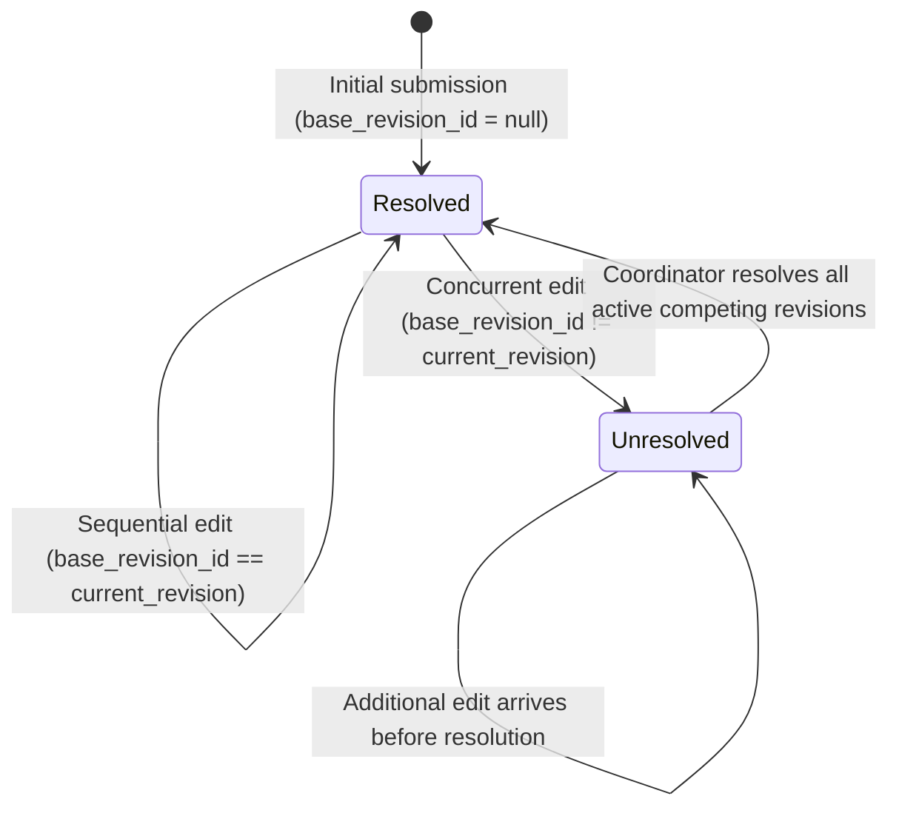

I have updated `docs/intent/record-store/record-store-design.md` to complete the `record-store` LLD around whole-visit revisions.

### Updated LLD (`docs/intent/record-store/record-store-design.md`)

```markdown
---
parent: high-level-design
prefix: REC
---

# Record Store

## Context and Design Philosophy

This node owns visit persistence, immutable submission history, and the meaning of a current visit when independently edited copies arrive. A visit is identified by a client-generated UUID and refers to a catalog plot UUID. Because field tablets operate offline for up to 48 hours, updates can arrive days after their starting state was fetched. The server never treats arrival order as evidence that one worker's observations are more authoritative than another's.

A visit's scientific fields—observation date, observer list, species cover estimates, and notes—frequently carry cross-field relationships, such as revising a species identification alongside its cover percentage or explanatory note. Because automated merge rules cannot reliably detect scientific coupling across distinct fields, the record store treats each submitted edit as an intact whole-visit revision (`REC-001`, `REC-004`). Concurrent edits from the same starting revision become competing whole-visit revisions for coordinator review rather than being automatically merged by field.

## Revision Model and State Transitions

Every accepted submission or coordinator resolution produces an immutable revision identified by a server-assigned `revision_id` and linked to its originating `submission_id`:

- **Initial creation**: A submission for a new `visit_id` carries `base_revision_id: null`. The server stores the submission, creates the initial revision as the visit's `current_revision`, and sets `review_status` to `resolved`.
- **Sequential update**: When a visit has `review_status: resolved` and an incoming submission's `base_revision_id` matches the visit's `current_revision`, the new revision becomes the `current_revision` and `review_status` remains `resolved`.
- **Concurrent update (competing revision)**: When an incoming submission's `base_revision_id` does not match the visit's `current_revision`, or when the visit is already `unresolved`, the server preserves the submission as a competing whole-visit revision (`REC-004`) and sets the visit's `review_status` to `unresolved` (`REC-005`).
- **Coordinator resolution**: A coordinator resolves an `unresolved` visit by selecting a competing revision or supplying a reconciled whole-visit payload along with the `contributing_revision_ids` reviewed. The server records the coordinator's identity and contributing IDs (`REC-006`), creates a new revision as `current_revision`, and returns `review_status` to `resolved` once no unaddressed competing revisions remain.



## Submission, Retrieval, and Resolution Contracts

### Submission Envelope and Validation

A submission request requires an authenticated worker identity (`author_id`) and supplies:

| Field | Type | Description |
|---|---|---|
| `visit_id` | UUID | Stable client-generated identifier for the plot visit |
| `idempotency_key` | UUID | Client-generated key unique to this submission attempt |
| `base_revision_id` | UUID or null | Revision ID the worker edited, or `null` for a newly created visit |
| `payload` | VisitPayload | Complete visit record: `plot_id`, `observation_date`, `observers`, `species_cover`, and `notes` |

Before accepting a submission, the record store validates field types and confirms that `plot_id` exists in `site-catalog`. Upon acceptance, the server records the raw submission with `visit_id`, `author_id`, and server receipt timestamp (`REC-001`), separate from any current-revision pointer or later coordinator resolution.

Retrying a request with an already-accepted `idempotency_key` and an identical envelope returns the original acceptance response (`submission_id`, `revision_id`, and resulting `review_status`) without creating a duplicate submission (`REC-002`). Reusing an accepted `idempotency_key` with any difference in `visit_id`, `base_revision_id`, or `payload` is rejected and leaves existing data unchanged (`REC-003`).

### Retrieval Operations

- **Visit retrieval**: Returns `visit_id`, `review_status` (`resolved` or `unresolved`), the `current_revision` (most recent settled revision), and when `unresolved`, the list of active competing revisions (each with `revision_id`, `submission_id`, `base_revision_id`, `author_id`, `received_at`, and intact `payload`) (`REC-005`).
- **History retrieval**: Returns the complete chronological sequence of original worker submissions and coordinator resolutions for a `visit_id`, preserving the lineage from every submitted observation to the current revision.

### Coordinator Resolution Operation

A resolution request requires an authenticated coordinator identity (`coordinator_id`) and supplies:

| Field | Type | Description |
|---|---|---|
| `visit_id` | UUID | The visit being resolved |
| `contributing_revision_ids` | UUID[] | The competing revision IDs reviewed and superseded by this resolution |
| `resolved_payload` | VisitPayload | Complete whole-visit record to establish as the new current revision |
| `resolution_notes` | string (optional) | Coordinator explanation for the resolved state |

The server persists the resolution with `coordinator_id`, timestamp, and `contributing_revision_ids` (`REC-006`), promotes the resulting revision to `current_revision`, and marks the addressed competing revisions as resolved.

## Downstream Contract Obligations

Completing this node defines the interfaces that sibling nodes must consume:

- **tablet-sync**: Must persist the `revision_id` of each synced visit as the `base_revision_id` for subsequent local edits, generate a stable `idempotency_key` per queued submission, and display when a synced submission produced an `unresolved` competing revision awaiting coordinator review.
- **review-export**: Must query `unresolved` visits, render competing whole-visit revisions for coordinator comparison, submit resolutions citing `contributing_revision_ids`, and exclude any visit with `review_status: unresolved` from the Friday partner CSV export.

## Decisions & Alternatives

| Decision | Chosen | Alternatives Considered | Rationale |
|---|---|---|---|
| Concurrent visit edit policy | Whole-visit revisions with base-revision tracking and coordinator resolution | Field-aware three-way merge using base snapshots and per-field merge rules | Field edits within a survey visit (such as changing a species identification and adjusting cover estimates or notes) can be scientifically coupled in ways field-level merge rules cannot detect. Whole-visit revisions keep each submitted visit intact, avoid maintaining merge rules across scalar and collection fields, and keep export provenance clear, trading a larger coordinator review queue for scientific integrity. |
| Retry deduplication | Client-supplied `idempotency_key` bound to the exact submission envelope | Time-window payload hashing; client-only retry tracking | Offline tablets retry over intermittent connectivity hours or days apart; binding a client key to the exact payload guarantees safe retries while rejecting accidental key reuse on modified drafts. |

## Open Questions & Future Decisions

### Deferred
1. Whether a coordinator resolution that addresses a subset of competing revisions (when another worker submission arrives mid-review) is rejected as stale or accepted while leaving the newly arrived revision `unresolved`.
2. Whether `plot_id` is immutable after a visit's initial submission or may be changed in a subsequent revision or resolution.
3. Exact validation rules and error status codes for malformed `base_revision_id` references (such as a non-null `base_revision_id` on a new `visit_id` or a `null` `base_revision_id` on an existing `visit_id`).

## References

- `docs/high-level-design.md`
- `docs/intent/site-catalog/site-catalog-design.md`
- `docs/intent/record-store/record-store-specs.md`
```

---

### Decision Recording Option

Because the concurrency choice (whole-visit revisions vs. field-aware three-way merge) weighs competing criteria—scientific integrity across coupled fields and merge-rule maintenance vs. coordinator review volume—and sizes the contracts of both `tablet-sync` and `review-export`, a future cold reader could be tempted to revisit it. Would you like to record this in a standalone decision doc at `docs/intent/record-store/decisions/concurrent-visit-edits.md` (linked from the table), or keep it solely as the `Decisions & Alternatives` row above?

---

### Phase 2 LLD Edge-Case Probe

Please review these internal `record-store` edge cases and let me know which ones you want to settle in the LLD now versus leave deferred:

1. **Late submission during coordinator resolution**: What happens when a coordinator submits a resolution whose `contributing_revision_ids` cover the competing revisions they loaded, but a new worker submission arrived in the meantime—should `record-store` reject the resolution as stale (requiring the coordinator to review the new revision too) or accept the resolution and keep `review_status: unresolved` for the remaining revision?
2. **Competing revision set membership**: When a `resolved` visit at `current_revision = R1` receives a concurrent edit `R2` based on an earlier revision `R0`, does the active competing revision list in `REC-005` (and required in `contributing_revision_ids` for `REC-006`) include **both** `R1` and `R2` as peers to compare, or only the divergent incoming revision `R2` alongside `current_revision = R1`?
3. **Invalid `base_revision_id` combinations**: What happens when a submission supplies a non-null `base_revision_id` for a brand-new `visit_id`, a `null` `base_revision_id` for an already-existing `visit_id`, or a `base_revision_id` that does not belong to that `visit_id`—should these be rejected with validation errors rather than treated as competing revisions?
4. **Plot reference mutability across revisions**: What happens when a subsequent worker edit or coordinator resolution for an existing `visit_id` changes `payload.plot_id` to a different plot UUID—is `plot_id` immutable once a visit is created, or can a revision move a visit to another plot if an observer initially picked the wrong plot?
5. **Idempotency on coordinator resolutions and author mismatches**:
   - What happens if an accepted worker `idempotency_key` is re-sent with the same payload by a different authenticated `author_id`?
   - Should coordinator resolution requests also carry an `idempotency_key` (or reject duplicate resolutions once the cited `contributing_revision_ids` are already superseded)?
6. **Domain validation on `VisitPayload`**: Beyond field types and `plot_id` existence in `site-catalog`, what domain invariants must `record-store` enforce on `VisitPayload` (e.g., non-empty `observers`, `species_cover` bounds `0–100`, duplicate species entries, or date bounds)?

---

### Cross-Segment Cascade Note

- `docs/high-level-design.md` (Architecture table row `Drafted; concurrency choice open` and prose noting the unresolved choice) and `docs/intent/site-catalog/site-catalog-design.md` (prose noting `tablet-sync` is pending the concurrency choice) still describe the concurrency choice as open. Should I update those references as well, or hold until we finish the `record-store` arrow?

Please let me know your preferences on the decision doc, which edge-case probe items to fold into the LLD vs. defer, and whether to proceed to **Phase 3 (EARS spec update for `record-store-specs.md`)**.