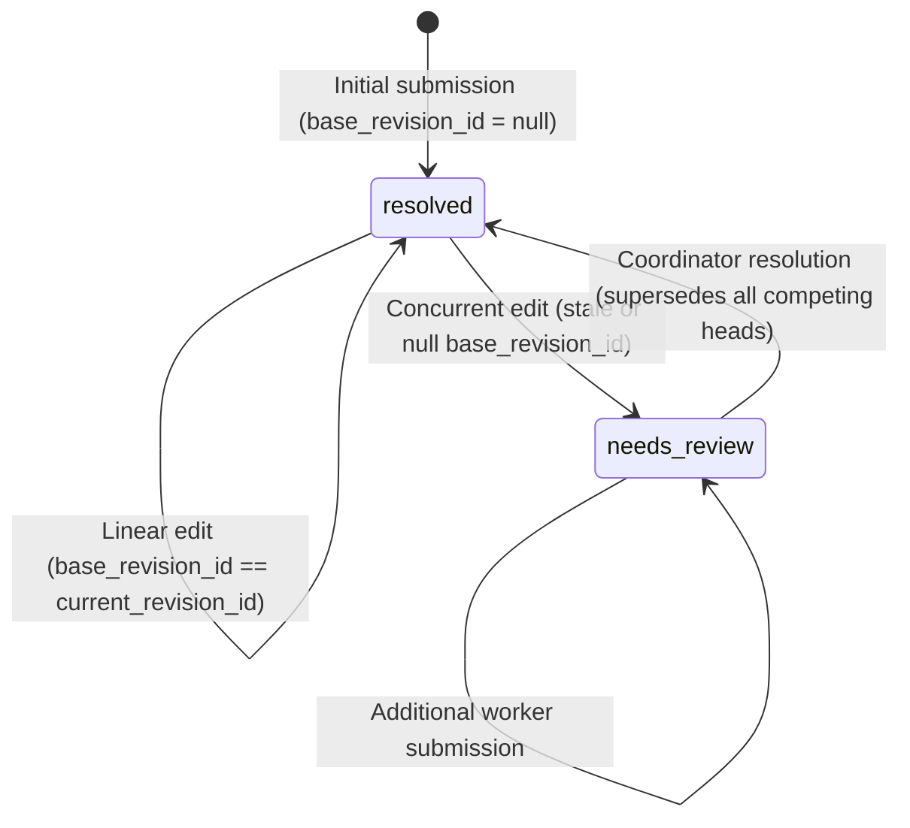

`docs/intent/record-store/record-store-design.md` has been updated for **Phase 2 (LLD)** around whole-visit revisions. Here is the updated LLD in full for review:

---

```markdown
---
parent: high-level-design
prefix: REC
---

# Record Store

## Context and Design Philosophy

Record Store owns durable visit persistence, whole-visit revision lineage, and the determination of whether a visit has a single current record or competing revisions awaiting coordinator review. Each visit is identified by a client-generated `visit_id` (UUID) and references a `plot_id` (UUID) from `site-catalog`.

Because field workers share offline tablets across 48-hour disconnections and independently correct visits after comparing field notes, edits frequently arrive days after their starting revision was fetched. Server receipt order does not indicate observational authority. A visit's scientific fields — `observation_date`, `observers`, `species_cover`, and `notes` — also carry cross-field relationships (such as revising a species identification together with its cover estimate) that cannot be inferred from field names. Every worker submission and coordinator resolution is therefore stored and evaluated as a complete, immutable visit revision.

## Revision Model and Visit States

Every accepted write creates an immutable revision with a server-assigned `revision_id` (UUID) and a complete `visit_payload`:

- `plot_id` — UUID of a plot in `site-catalog`
- `observation_date` — survey date (`YYYY-MM-DD`)
- `observers` — non-empty list of observer names
- `species_cover` — list of species entries and cover estimates
- `notes` — free-text visit notes

Revisions have two kinds:

- `worker_submission` — records `author_id`, `received_at`, `idempotency_key`, and `base_revision_id` (`null` for initial capture of a new visit, or the `revision_id` from which the edit started).
- `coordinator_resolution` — records `coordinator_id`, `resolved_at`, `contributing_revision_ids` (the active head revisions superseded by the resolution), and an optional `resolution_note`.

Original revisions are never mutated or deleted. Each visit tracks its active head set (revisions not yet superseded by a descendant edit or coordinator resolution), which determines its `review_status`:

- `resolved` — exactly one active head exists (`current_revision_id`). The visit has an authoritative current state and is eligible for Friday CSV export.
- `needs_review` — two or more active heads exist (`competing_revision_ids`). `current_revision_id` is `null`, and the visit is held out of CSV export until a coordinator resolves the competing heads.



### Head Set Transitions

Writes targeting the same `visit_id` execute atomically so concurrent requests cannot race on head-set evaluation:

1. **New visit**: When `visit_id` does not yet exist and `base_revision_id` is `null`, the stored revision becomes the sole active head (`review_status = resolved`, `current_revision_id = revision_id`, `competing_revision_ids = []`).
2. **Linear edit**: When `visit_id` is `resolved` and `base_revision_id` equals `current_revision_id`, the new revision supersedes that head and becomes the sole active head (`review_status = resolved`, `current_revision_id = revision_id`, `competing_revision_ids = []`).
3. **Branching edit**: When `visit_id` already exists and an accepted worker submission has `base_revision_id: null` (independent offline creation of the same `visit_id`), names an ancestor revision older than an active head, or arrives while `visit_id` is already `needs_review`:
   - If `base_revision_id` matches an active head in `competing_revision_ids`, the new revision supersedes that specific branch head in the active head set.
   - If `base_revision_id` is `null` or an already-superseded ancestor revision, the new revision is added as an additional head in `competing_revision_ids`.
   - Whenever two or more active heads remain, `review_status` is `needs_review` and `current_revision_id` is `null`.
4. **Resolution**: When a coordinator resolves `competing_revision_ids`, the new `coordinator_resolution` revision supersedes every revision in `competing_revision_ids` and becomes the sole active head (`review_status = resolved`, `current_revision_id = revision_id`, `competing_revision_ids = []`).

## Operations and Envelope Contracts

| Operation | Caller | Request | Response |
|---|---|---|---|
| `SubmitVisitRevision` | Authenticated worker | `idempotency_key`, `visit_id`, `base_revision_id`, `visit_payload` | `visit_id`, `accepted_revision_id`, `review_status`, `current_revision_id`, `competing_revision_ids` |
| `GetVisit` | Worker or coordinator | `visit_id` | `visit_id`, `review_status`, `current_revision` (if `resolved`), `competing_revisions` + `common_base_revision` (if `needs_review`) |
| `ListVisits` | Worker or coordinator | Optional filters: `review_status`, `updated_since` cursor | Paginated visit summaries / representations matching filter |
| `GetVisitHistory` | Worker or coordinator | `visit_id` | Full revision lineage (`worker_submission` and `coordinator_resolution` records) |
| `ResolveVisitReview` | Authenticated coordinator | `idempotency_key`, `visit_id`, `expected_competing_revision_ids`, `visit_payload`, `resolution_note` (optional) | `visit_id`, `resolution_revision_id`, `review_status` (`resolved`), `current_revision` |

### Submission Validation and Idempotency

`SubmitVisitRevision` authenticates the worker and validates the envelope before persisting:

- **Plot reference**: `visit_payload.plot_id` must exist in `site-catalog`. Both active and archived plot UUIDs are accepted so offline observations captured before a plot archival or historical visit edits are never rejected on sync; unknown plot UUIDs are rejected.
- **Lineage validity**: If `visit_id` does not exist, `base_revision_id` must be `null`. If `base_revision_id` is non-null, it must reference an existing revision belonging to `visit_id`; unknown revision IDs or revisions from a different visit are rejected.
- **Idempotency**: `idempotency_key` deduplicates retries across dropped tablet connections. Repeating an accepted `idempotency_key` with an identical request (`visit_id`, `base_revision_id`, and `visit_payload`) returns the original acceptance response without creating another revision. Reusing an accepted `idempotency_key` with any difference in `visit_id`, `base_revision_id`, or `visit_payload` is rejected with a conflict error and leaves stored state unchanged.

### Retrieval and Unresolved-Work Representation

`GetVisit` and `ListVisits` make export eligibility and review work explicit in the response structure:

- When `review_status` is `resolved`, `current_revision` contains the active head revision (`revision_id`, `kind`, actor identity, timestamp, lineage pointer, and `visit_payload`), and `competing_revisions` is empty.
- When `review_status` is `needs_review`, `current_revision` is `null`. `competing_revisions` returns all active head revisions in full, and `common_base_revision` returns their nearest shared ancestor revision (`null` if competing heads originated from independent `base_revision_id: null` submissions). Returning `null` for `current_revision` prevents callers from accidentally treating an arbitrary competing revision as authoritative.

`GetVisitHistory` returns every revision ever recorded for `visit_id` with its lineage links (`base_revision_id` or `contributing_revision_ids`), actor identity, server timestamp, and full `visit_payload`, keeping the path from submitted field observations to exported CSV rows inspectable.

### Coordinator Resolution

`ResolveVisitReview` requires coordinator authorization and resolves an open conflict by creating a new `coordinator_resolution` revision:

- The coordinator supplies `visit_payload` — either one competing revision's payload chosen intact or a reconciled complete visit assembled from the competing revisions, validated against the same field and `plot_id` rules as worker submissions — together with `expected_competing_revision_ids`.
- The store verifies that `visit_id` is currently `needs_review` and that its active `competing_revision_ids` set equals `expected_competing_revision_ids`. If a late tablet submission arrived while the coordinator was reviewing and changed the active head set, the store rejects the resolution with a stale-review conflict so the newly arrived revision is reviewed rather than silently superseded.
- Repeating an accepted resolution `idempotency_key` with an identical request returns the original resolution response; reusing it with a different payload or competing set is rejected.

## Downstream Component Contracts

- **tablet-sync**: Caches `current_revision.revision_id` as the local `base_revision_id` before offline edits, submits complete visit payloads with a client-generated `idempotency_key`, and surfaces `needs_review` responses and `competing_revisions` to field workers without discarding local context.
- **review-export**: Queries `ListVisits(review_status = needs_review)` to populate the coordinator queue, renders side-by-side comparison using `competing_revisions` and `common_base_revision`, records decisions via `ResolveVisitReview`, and exports only `resolved` visits (`current_revision`) in the Friday CSV.

## Decisions & Alternatives

| Decision | Chosen | Alternatives Considered | Rationale |
|---|---|---|---|
| Concurrent visit edit policy | Whole-visit immutable revisions with `base_revision_id` lineage and coordinator resolution | Field-aware three-way merge with base snapshots and structured diffs; last-write-wins by timestamp | Visit fields have cross-field scientific dependencies (such as species identification paired with cover estimate) that automated field-level merge rules cannot detect. Whole-visit revisions keep each worker's observation intact and avoid maintaining per-field merge rules for two coordinators, accepting a larger review queue in exchange. Timestamp overwrite violates the tenet against silently discarding submitted edits after offline work. |
| `current_revision` while `needs_review` | Set `current_revision` to `null` and return `competing_revisions` explicitly | Expose earliest-received or latest-received revision as provisional `current_revision` alongside a flag | Receipt order after 48-hour offline periods carries no authority, and exposing a provisional current record risks downstream callers exporting an unreviewed revision. |
| Coordinator resolution storage | Append a `coordinator_resolution` revision citing `contributing_revision_ids`, guarded by `expected_competing_revision_ids` | Flag an existing worker submission as winner in place; overwrite without checking active heads | Coordinators may either adopt one worker revision intact or combine details across competing revisions; a new immutable revision represents both uniformly while preserving original worker submissions, and matching `expected_competing_revision_ids` prevents late-syncing worker edits from being silently buried. |
| Plot reference validation on sync | Accept any plot UUID present in `site-catalog`, whether active or archived | Reject submissions referencing archived plots | A plot may be archived while a tablet is offline for 48 hours, or a worker may correct an older visit on an archived plot; accepting archived catalog UUIDs preserves field work while still rejecting unknown plot IDs. |

## References

- High-Level Design: `docs/high-level-design.md`
- Site Catalog LLD: `docs/intent/site-catalog/site-catalog-design.md`
- Record Store EARS Specs: `docs/intent/record-store/record-store-specs.md`
```

---

### 1. Decision Doc vs. Table Row

Because whole-visit revisions vs. field-aware three-way merge trades two credible options across multiple criteria (cross-field scientific integrity, coordinator review load, merge-rule maintenance) and sizes both `tablet-sync` and `review-export` around the result, a future cold reader could be tempted to revisit it. Would you like a standalone decision doc at `docs/intent/record-store/decisions/concurrent-visit-edits.md` linked from `Decisions & Alternatives`, or keep just the table row above?

### 2. Phase 2 LLD Edge-Case Probe (Triage: Fix in LLD vs. Defer)

A blind probe of `record-store-design.md` surfaced six internal gaps/ambiguities. Let me know which to settle in the LLD now versus defer under `Open Questions & Future Decisions`:

1. **Idempotency replay after later writes & key scope**: When an accepted `idempotency_key` is replayed after subsequent edits or resolutions have changed the visit's active heads, should it return a frozen snapshot of the original acceptance response (evaluated before `expected_competing_revision_ids` preconditions on `ResolveVisitReview`) or the original `revision_id` paired with the visit's live head state — and are keys scoped per actor or globally across `record-store`?
2. **`plot_id` mutability across revisions**: Can a later worker edit or coordinator resolution change `visit_payload.plot_id` for an existing `visit_id` (e.g., fixing a mis-selected plot while preserving the visit ID), or is `plot_id` immutable after initial creation?
3. **Identical-payload concurrent branches**: If two offline submissions branch from the same `base_revision_id` (or both arrive with `base_revision_id: null` for the same `visit_id`) with identical `visit_payload`s, should they still enter `needs_review` as separate competing heads or coalesce automatically?
4. **`common_base_revision` across post-resolution DAGs and 3+ heads**: When a late offline edit branches from an ancestor (`A`) already superseded by a `coordinator_resolution` (`C1`), should `common_base_revision` traverse `contributing_revision_ids` as well as `base_revision_id` (making `A` the shared base), and yield `null` whenever 3+ competing heads have no single ancestor shared by *all* active heads?
5. **Payload field invariants**: Beyond `plot_id` lookup and non-empty `observers`, what structural validation belongs in `record-store` for `observation_date`, `species_cover` entries (schema, cover bounds, duplicate species), and `notes` (keeping non-goal botanical validation out of scope)?
6. **`ListVisits` shape, cursor ordering, and error contract**: Should `ListVisits` return full `GetVisit` structures (including full `competing_revisions`) or lighter summaries, how should `updated_since` break ties on identical timestamps, and what error shapes should distinguish `ResolveVisitReview` on an already-`resolved` visit vs. a stale-review conflict (e.g., returning current `competing_revision_ids` in the conflict error)?

### 3. Cross-Node References Flagged (Not Edited Yet)

- `docs/high-level-design.md` (`State` column `Drafted; concurrency choice open` and prose calling the choice unresolved) and `docs/intent/site-catalog/site-catalog-design.md` ("pending that choice") still refer to `record-store`'s concurrency choice as open. Let me know if you want those updated alongside LLD approval.

Once you confirm any edits from the items above and approve the LLD, we will proceed to **Phase 3** (`docs/intent/record-store/record-store-specs.md`).