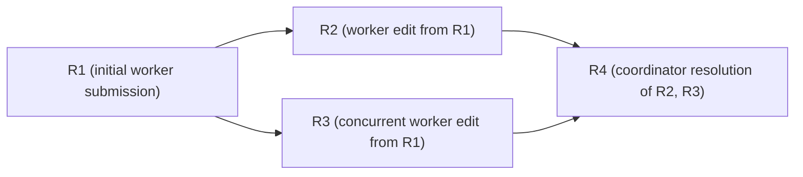

`docs/intent/record-store/record-store-design.md` is updated for whole-visit revisions (and `docs/high-level-design.md`'s architecture table now marks `record-store` as `Drafted` rather than `concurrency choice open`).

### Updated LLD: `docs/intent/record-store/record-store-design.md`

````markdown
---
parent: high-level-design
prefix: REC
---

# Record Store

## Context

This node owns visit persistence, whole-visit revision lineage, and the boundary between a single usable current visit and unresolved competing edits. A visit is identified by a client-generated UUID (`visit_id`) and refers to a catalog plot UUID (`plot_id`). Because field tablets operate offline for up to 48 hours, edits can arrive days after their starting state was fetched; server arrival order is never treated as evidence that one worker's observations are more authoritative than another's.

A visit's scientific payload contains observation date, observer list, species cover estimates, and notes. Edits across fields within the same visit can be scientifically coupled—such as revising a species identification alongside its cover estimate or explanatory note—in ways the server cannot infer from field names. Each submission and resolution therefore captures and versions the complete visit as an atomic unit rather than merging individual fields automatically.

## Revision Lineage Model

Every accepted worker submission and every coordinator resolution creates an immutable revision (`revision_id`, server-assigned UUID) storing a complete visit payload. Original submissions are never mutated or overwritten.

Revisions form a directed acyclic graph per visit:

- **Worker submission revision** (`origin: worker_submission`): records `revision_id`, `visit_id`, `base_revision_id` (`null` for initial visit creation; otherwise the `revision_id` the worker edited from), `author_id`, `received_at` (server receipt timestamp), `idempotency_key`, and `payload`.
- **Coordinator resolution revision** (`origin: coordinator_resolution`): records `revision_id`, `visit_id`, `contributing_revision_ids` (the two or more competing revision IDs superseded by the resolution), `resolved_by` (coordinator identity), `resolved_at`, `idempotency_key`, and `payload`.

An **active head revision** is any revision of a visit that is neither referenced as `base_revision_id` by a later worker revision nor listed in `contributing_revision_ids` of a coordinator resolution. Visit state derives directly from the active head count:

- **`resolved` (1 active head)**: that sole head is the visit's `current_revision`.
- **`unresolved` (2 or more active heads)**: the active heads are `competing_revisions` awaiting coordinator review, and `current_revision` is `null`.



State transitions on accepted worker submissions:

1. **Initial creation** (`base_revision_id = null` for a new `visit_id`): creates `R1` as the sole active head (`status: resolved`).
2. **Linear edit** (`base_revision_id` matches the visit's sole active head): supersedes that head and makes the new revision the sole active head (`status: resolved`).
3. **Concurrent edit from a superseded revision** (`base_revision_id` references an existing non-head ancestor revision of the visit): preserves both branches, adding the new revision as an additional active head (`status: unresolved`).
4. **Follow-up edit from a competing head** (`base_revision_id` matches one of several active heads): supersedes that specific active head while other branches remain active (`status: unresolved`).

## Submission Contract

| Field | Type | Constraints |
|---|---|---|
| `idempotency_key` | string | Client-generated unique token per logical submission |
| `visit_id` | UUID | Client-generated visit identifier |
| `base_revision_id` | UUID \| null | `null` only when creating a new visit; existing `revision_id` of `visit_id` for edits |
| `payload.plot_id` | UUID | Must exist in `site-catalog` (active or archived) |
| `payload.observation_date` | ISO-8601 date | Calendar date of survey |
| `payload.observers` | list of non-empty strings | At least one observer name |
| `payload.species_cover` | list of species-cover entries | Species identifier and numeric cover estimate per entry |
| `payload.notes` | string | Optional free-text notes (may be empty) |

Authentication and validation rules:

- Authenticate the submitting worker (`author_id`) before evaluating idempotency or payload rules.
- **Idempotency**: if `idempotency_key` matches a previously accepted worker submission with an identical request (`visit_id`, `base_revision_id`, `payload`, and `author_id`), return the original acceptance result without storing a duplicate revision. If `idempotency_key` was already accepted with any differing field, reject the request and leave stored state unchanged.
- **Plot validation**: verify `payload.plot_id` resolves in `site-catalog`. Archived plot UUIDs remain valid so historical or delayed offline visits can still be submitted and corrected.
- **Lineage validation**: reject if `base_revision_id` is `null` for an already-existing `visit_id`, if `base_revision_id` is non-null for an unknown `visit_id`, or if `base_revision_id` does not belong to `visit_id`.

An accepted submission returns `visit_id`, the newly assigned `revision_id`, `received_at`, resulting `status` (`resolved` | `unresolved`), `current_revision_id` (non-null only when `resolved`), and `active_head_revision_ids`.

## Current-State and History Retrieval

The store exposes three read surfaces:

- **Current-state retrieval (`visit_id`)**: returns `visit_id`, `status` (`resolved` | `unresolved`), `current_revision` (the full head revision when `resolved`, or `null` when `unresolved`), and `competing_revisions` (empty list when `resolved`; all active head revisions ordered deterministically by revision timestamp—`received_at` for worker submissions, `resolved_at` for coordinator resolutions—ascending, then `revision_id` when `unresolved`). Ordering in `competing_revisions` is for stable presentation only and confers no authority.
- **Status-filtered listing**: lists visits filtered by `status` (`resolved` or `unresolved`) so callers can enumerate unresolved review work or export-eligible visits without scanning every revision.
- **Revision-history retrieval (`visit_id`)**: returns all stored revisions for the visit (both `worker_submission` and `coordinator_resolution` records with their full payloads, provenance metadata, and parent links) in chronological receipt/resolution order, enabling callers to locate common base revisions for comparison and audit the path from submitted observations to exported values.

## Coordinator Resolution Contract

A coordinator resolves competing revisions by submitting a complete reconciled visit payload—either matching one competing revision or manually synthesized after comparing them—together with the competing revision IDs inspected:

| Field | Type | Constraints |
|---|---|---|
| `idempotency_key` | string | Client-generated unique token per logical resolution |
| `visit_id` | UUID | Target visit |
| `contributing_revision_ids` | set of UUIDs | Must contain at least two IDs and equal the visit's current active head set |
| `payload` | VisitPayload | Validated under the same field and `plot_id` rules as worker submissions |

Resolution rules:

- Authenticate and authorize the caller as a coordinator (`resolved_by`).
- Evaluate `idempotency_key` before active-head checks: an identical retry of a previously accepted resolution returns the original resolution outcome even though the visit is now `resolved`; reusing an accepted key with different inputs is rejected.
- Require `contributing_revision_ids` to match the visit's exact current set of active head revisions (with cardinality >= 2). If the visit is already `resolved`, if another coordinator resolved it concurrently, or if a newly synced worker submission added or advanced an active head since the coordinator loaded the visit, reject the resolution as a stale-head conflict and return the current active heads.
- Store a new `coordinator_resolution` revision recording `resolved_by`, `resolved_at`, `contributing_revision_ids`, and `payload` while retaining every contributing submission untouched. The resolution revision becomes the sole active head (`status: resolved`, `current_revision` set to the resolution revision), and the response returns `visit_id`, `revision_id`, `resolved_at`, `status` (`resolved`), and `current_revision_id`.

## Downstream Contract Obligations

Sibling nodes consume this contract without defining independent concurrency rules:

- **`tablet-sync`**: persists the `revision_id` of the revision a local draft started from as `base_revision_id` (`null` for newly created offline visits), submits complete visit payloads with durable `idempotency_key` values across retries, updates its stored base revision from the accepted response when `resolved`, and surfaces `unresolved` status and `competing_revisions` when concurrent edits occur.
- **`review-export`**: queries `unresolved` visits for the coordinator queue, uses revision history alongside `competing_revisions` to render whole-visit comparisons against common base revisions, submits coordinator resolutions naming `contributing_revision_ids`, and restricts reviewed CSV export to `resolved` visits' `current_revision`.

## Decisions & Alternatives

| Decision | Chosen | Alternatives Considered | Rationale |
|---|---|---|---|
| Concurrent visit edit policy | Whole-visit revisions with coordinator resolution of competing heads | Field-aware three-way merge; arrival-order overwrite (last-write-wins) | Keeps each submitted visit intact as a scientific observation unit and avoids maintaining field-merge rules that could silently combine botanically coupled edits across fields (such as species identification and cover estimates). Arrival-order overwrite is unacceptable because offline delay does not make an edit less authoritative and would silently lose observations. Trades a larger coordinator review queue on unrelated concurrent field edits for simpler rules and preserved scientific intent. |
| Unresolved current-state representation | `current_revision: null` plus explicit `competing_revisions` list | Expose latest-arriving revision as tentative `current_revision` with a review flag | Prevents callers from treating receipt order as authority or accidentally exporting an unreviewed competing revision; consumers must handle unresolved visits explicitly. |
| Stale-head handling during coordinator resolution | Require `contributing_revision_ids` to match the full current active head set; reject on mismatch | Supersede only listed revisions and leave newly arrived heads active alongside the resolution; last-resolution-wins | Guarantees a coordinator sees every active competing submission before settling the current state and prevents two coordinators from silently overwriting each other's resolutions. |

## References

- `docs/high-level-design.md`
- `docs/intent/site-catalog/site-catalog-design.md`
- `docs/intent/record-store/record-store-specs.md`
````

---

### Decision Recording Option

Because a future maintainer seeing coordinators manually resolve non-overlapping field edits could reasonably re-open field-aware three-way merge—and both `tablet-sync` and `review-export` are about to be sized around this contract—this choice qualifies for a standalone decision doc:

- **Option A**: Draft `docs/intent/record-store/decisions/concurrent-visit-edits.md` laying out the criteria, both options, and selection rationale, linked from `record-store-design.md`'s `Decisions & Alternatives` row.
- **Option B**: Keep only the `Decisions & Alternatives` table row already in `record-store-design.md`.

---

### Phase 2 LLD Edge-Case Probe (Triage: Fix Now vs. Defer)

An independent cold-read probe against `record-store-design.md` surfaced these internal edge cases for you to triage (fix in the LLD now vs. record under `Open Questions & Future Decisions`):

1. **Changing `plot_id` on an existing visit**: May a follow-up worker edit or coordinator resolution change `payload.plot_id` (e.g., if a crew initially selected the wrong plot in the field), or is `plot_id` immutable once `visit_id` is created?
2. **Identical concurrent payloads**: If two offline workers branch from the same `base_revision_id` and submit byte-identical `payload` values under distinct `idempotency_key`s, should `record-store` still mark the visit `unresolved` for coordinator resolution or auto-converge to one head while retaining both original submissions?
3. **Minimal structural bounds on `species_cover` and `observation_date`**: May `species_cover` be empty (e.g., bare/scoured plot with zero vegetation) or contain duplicate species entries, and should cover estimates only enforce non-negative finite numbers (avoiding botanical validation per HLD non-goals) or a fixed numeric range such as `0–100`?
4. **Idempotency key scope, replay snapshot, and rejected-key reuse**: Should `idempotency_key` uniqueness be scoped per authenticated actor or globally; should a replay after later edits return the acceptance snapshot as of original receipt or the original `revision_id` with current visit status; and may a client reuse an `idempotency_key` whose prior attempt was rejected?
5. **Read-surface access and listing shape**: Are all three read surfaces open to both authenticated workers and coordinators, and should status-filtered listing return full current/competing revision envelopes or lightweight visit summaries (paginated vs. unpaginated at ~6,000 visits/season)?
6. **Error and conflict response shapes**: When coordinator resolution fails the active-head check or targets an unknown `visit_id`, should the error distinguish `not_found`, `already_resolved`, and `stale_heads`, and embed full active head revisions or only their `revision_id`s?

---

### Cross-Segment Note

`docs/intent/site-catalog/site-catalog-design.md` (line 24) still says *"Tablet-sync's visit submission and reconciliation behavior remains pending that choice."* Paused before touching `site-catalog` across the segment boundary—let me know if you want that line updated as well.

---

**Phase 2 Stop — Ready for your review:**
1. Does the `record-store` LLD match your intent (including the `current_revision: null` representation when unresolved and the exact-head-set check on coordinator resolution)?
2. Which probe items (1–6) would you like settled in `record-store-design.md` now versus deferred?
3. Would you like a standalone decision doc (`Option A`) or just the table row (`Option B`)?

Once you approve the Phase 2 LLD, we'll proceed to Phase 3 (`docs/intent/record-store/record-store-specs.md`) before moving on to `tablet-sync` and `review-export`.