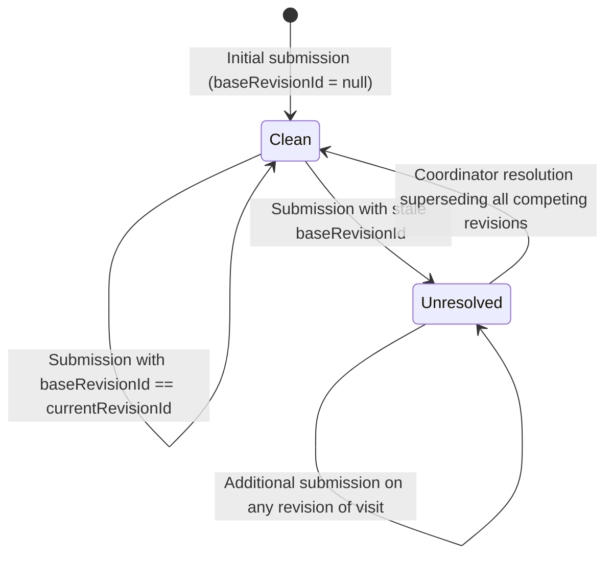

`docs/intent/record-store/record-store-design.md` is updated with the whole-visit revision design, and `docs/high-level-design.md` is updated to mark `record-store` as `Drafted` rather than `concurrency choice open`.

---

### Updated LLD (`docs/intent/record-store/record-store-design.md`)

````markdown
---
parent: high-level-design
prefix: REC
---

# Record Store

## Context

This node owns visit persistence, revision history, and the meaning of a current visit when independently edited copies arrive from offline tablets. A visit is identified by a client-generated `visitId` (UUID) and refers to a `plotId` (UUID) from `site-catalog`. Updates can arrive days after their starting state was fetched, and arrival order at the server is not evidence that one worker's observations are more authoritative than another's.

A visit's scientific fields — observation date, observer list, species cover estimates, and notes — form a single field observation set. Edits across those fields can be scientifically coupled (for example, revising a species identification alongside its cover estimate) in ways field names alone do not reveal. Every worker submission and coordinator resolution therefore carries a complete visit payload, and concurrent edits become competing whole-visit revisions for coordinator review.

## Architecture

The record store exposes authenticated operations for visit submission, current-state retrieval, submission-history retrieval, unresolved-review listing, and coordinator resolution. Persistence stores three append-only record types per visit:

- **Submissions**: every accepted worker upload, retaining `submissionId`, `visitId`, `authorId`, `receivedAt` (server receipt timestamp), `idempotencyKey`, `baseRevisionId`, and the unmodified submitted `payload`.
- **Revisions**: immutable whole-visit snapshots (`revisionId`, `visitId`, `baseRevisionId` or `supersededRevisionIds`, provenance pointer to the originating `submissionId` or `resolutionId`, actor identity, timestamp, and `payload`).
- **Resolutions**: coordinator review outcomes (`resolutionId`, `visitId`, `coordinatorId`, `resolvedAt`, `supersededRevisionIds`, `contributingSubmissionIds`, resulting `revisionId`, and optional `resolutionNote`).



Each visit has one of two review states:

- **`clean`**: exactly one un-superseded revision exists (`currentRevisionId`). That revision is the usable current state and is eligible for downstream export.
- **`unresolved`**: two or more un-superseded revisions compete. No candidate revision is exposed as a settled current state until a coordinator resolves the competing set.

## Submission Envelope and Validation

| Field | Type | Description |
|---|---|---|
| `idempotencyKey` | string | Client-generated token identifying a single submission attempt across retries |
| `visitId` | UUID | Client-generated visit identifier |
| `baseRevisionId` | UUID \| null | Revision the tablet started from; `null` when creating a new visit |
| `payload` | VisitPayload | Complete visit record: `plotId`, `observationDate`, `observers`, `speciesCoverEstimates`, `notes` |

Before accepting a submission, the record store authenticates the submitting worker (binding `authorId` from the authenticated identity), validates visit field types and required fields, verifies that `payload.plotId` resolves to a known plot UUID in `site-catalog`, and checks that any non-null `baseRevisionId` belongs to `visitId`.

Idempotency prevents duplicate edits across dropped tablet connections:

- Repeating an accepted `idempotencyKey` with an identical submission envelope (`visitId`, `baseRevisionId`, and `payload`) returns the original acceptance response without storing another submission or revision (`REC-002`).
- Repeating an accepted `idempotencyKey` with a different envelope is rejected (`409 Conflict`) and leaves stored state unchanged (`REC-003`).

When a new submission is accepted (`REC-001`, `REC-004`):

1. If `baseRevisionId` is `null` and the visit does not yet exist, the store creates initial revision `R1` and sets `reviewStatus = clean` with `currentRevisionId = R1`.
2. If the visit is `clean` and `baseRevisionId` equals `currentRevisionId`, the new revision supersedes `currentRevisionId` and the visit remains `clean`.
3. If the visit is `clean` and `baseRevisionId` refers to an earlier revision of `visitId`, the new revision is stored alongside the previously current revision as an active candidate; the visit transitions to `unresolved` with both revisions in `competingRevisions`.
4. If the visit is already `unresolved` and `baseRevisionId` refers to any existing revision of `visitId`, the new revision joins `competingRevisions` and the visit remains `unresolved`.

The acceptance response returns `submissionId`, created `revisionId`, `visitId`, `receivedAt`, `reviewStatus`, `currentRevisionId` (`null` when `unresolved`), and `competingRevisionIds` (empty when `clean`).

## Retrieval and Unresolved-Work Representation

Current-state retrieval (`GET` by `visitId`, plus filtered listing for sync and export) distinguishes settled visits from visits awaiting coordinator review (`REC-005`):

- **When `reviewStatus` is `clean`**: returns `visitId`, `plotId`, `reviewStatus: "clean"`, `currentRevision` (`revisionId`, provenance, timestamp, and complete `payload`), and `unresolvedReview: null`.
- **When `reviewStatus` is `unresolved`**: returns `visitId`, `plotId`, `reviewStatus: "unresolved"`, `currentRevision: null`, and `unresolvedReview`:
  - `competingRevisions`: all active un-superseded revisions for the visit, each with `revisionId`, `baseRevisionId`, originating `submissionId` or `resolutionId`, actor ID, timestamp, and complete `payload`.
  - `baseRevisions`: the full revision records referenced by each non-null `baseRevisionId` in `competingRevisions`, giving comparison views the exact starting state each edit diverged from.

Submission-history retrieval for a `visitId` returns the chronological audit trail of all accepted worker submissions and coordinator resolutions, keeping original submitted payloads separate from and inspectable alongside subsequent revisions.

## Coordinator Resolution

To resolve an `unresolved` visit, an authenticated coordinator submits:

| Field | Type | Description |
|---|---|---|
| `idempotencyKey` | string | Client-generated token preventing duplicate resolution records on retry |
| `visitId` | UUID | Visit being resolved |
| `supersededRevisionIds` | UUID[] | Exact set of active competing `revisionId`s reviewed by the coordinator |
| `payload` | VisitPayload | Complete reconciled visit record (selected intact from one candidate or manually synthesized by the coordinator) |
| `resolutionNote` | string \| null | Optional note recording why the reconciled state was chosen |

Idempotency replay runs before concurrency validation: repeating an accepted resolution `idempotencyKey` with an identical resolution envelope returns the original acceptance response, while repeating it with a different envelope is rejected (`409 Conflict`). For a new key, `supersededRevisionIds` acts as an optimistic concurrency guard and must match the visit's active `competingRevisions` set at resolution time. If another tablet submission or coordinator resolution arrived while the coordinator was reviewing, the request is rejected (`409 Conflict`) so no unseen revision is silently superseded.

On acceptance, the store validates `payload` under the same rules as a worker submission, records the resolution with `coordinatorId`, `resolvedAt`, `supersededRevisionIds`, and `contributingSubmissionIds` (all worker `submissionId`s represented across the superseded competing branches, `REC-006`), creates a new revision carrying `payload`, and transitions the visit to `clean` with `currentRevision` set to that revision. The acceptance response returns `resolutionId`, created `revisionId`, `visitId`, `resolvedAt`, `reviewStatus: "clean"`, and `currentRevisionId`. All superseded revisions and original submissions remain intact in history.

## Downstream Contract Obligations

- **`tablet-sync`**: retains `currentRevision.revisionId` as the local `baseRevisionId` when caching a `clean` visit; submits complete visit payloads with `idempotencyKey` and `baseRevisionId`; surfaces `unresolved` status and competing revisions when a submission enters review or a synced visit has pending review work.
- **`review-export`**: queries visits with `reviewStatus: "unresolved"` for the coordinator queue, renders whole-visit comparison of `competingRevisions` against `baseRevisions`, submits coordinator resolutions with `supersededRevisionIds`, and includes only `reviewStatus: "clean"` visits in the Friday partner CSV.

## Decisions & Alternatives

| Decision | Chosen | Alternatives Considered | Rationale |
|---|---|---|---|
| Concurrent visit edit policy | Whole-visit revisions | Field-aware three-way merge; last-arrival overwrite | Last-arrival overwrite silently discards edits. Field-aware three-way merge lowers review volume for disjoint edits, but requires maintained merge rules across scalar fields, observer lists, and species entries and can combine scientifically coupled edits (such as a revised species identification and its cover estimate) without coordinator review. Whole-visit revisions keep each worker's observation set intact and keep server rules simple for a two-coordinator workflow. |
| Current-state exposure during unresolved review | Set `currentRevision` to `null` and expose `unresolvedReview` while competing revisions exist | Keep the earlier-arriving revision as `currentRevision` until resolved | Treating the earlier-arriving edit as a usable current state lets sync timing decide authority and risks exporting an unreviewed competing revision. |
| Resolution concurrency control | Require `supersededRevisionIds` to match active `competingRevisions` | Resolve unconditionally by `visitId` | Resolving by `visitId` alone would silently supersede a late offline submission that arrived while a coordinator had the comparison view open. |

## References

- High-level design: `docs/high-level-design.md`
- Plot reference source: `docs/intent/site-catalog/site-catalog-design.md`
- EARS specifications: `docs/intent/record-store/record-store-specs.md`
````

---

### Decision Doc Offer

Because whole-visit revisions vs. field-aware three-way merge trades two real pressures against each other (coordinator queue volume and Friday export readiness vs. merge-rule maintenance and silent cross-field scientific coupling) and both `tablet-sync` and `review-export` will be sized around this choice, a cold reader seeing unrelated field edits land in manual review could be tempted to revisit it.

- **Option A**: Record a standalone decision doc at `docs/intent/record-store/decisions/concurrent-visit-edits.md` and link it from `record-store`'s `Decisions & Alternatives` row.
- **Option B**: Keep the `Decisions & Alternatives` table row in `record-store-design.md` on its own.

Which do you prefer?

---

### Phase 2 LLD Edge-Case Probe

A zero-context edge-case probe on `record-store-design.md` surfaced these component-internal questions. Let me know which ones you want settled in the LLD now versus deferred under `Open Questions & Future Decisions`:

1. **Follow-up edit on a competing revision while `unresolved`**: If `[R2, R3]` are competing and a worker submits `R4` with `baseRevisionId = R2`, should `R4` supersede `R2` within the competing set (leaving `[R3, R4]` for the coordinator), or leave both `R2` and `R4` active (`[R2, R3, R4]`)?
2. **`plotId` mutability on an existing visit**: Is `plotId` fixed when a `visitId` is created (rejecting edits/resolutions that change `plotId`), or can a visit's `plotId` be corrected in a later revision (which means competing revisions could temporarily disagree on `plotId`)?
3. **Second `baseRevisionId = null` on an existing `visitId` (new `idempotencyKey`)**: Should `record-store` reject a `null`-base submission for an already-existing `visitId` (`409 Conflict`), or accept it into `competingRevisions` as another root candidate (for example, if a tablet lost local sync state after submitting)?
4. **Identical-payload concurrent submission**: If a stale-base submission carries a `payload` identical to `currentRevision` (or an existing competing revision), should it still create a competing revision and require coordinator review, or record the submission in history without opening/extending review work?
5. **`contributingSubmissionIds` scope on resolution (`REC-006`)**: When a competing branch has multiple sequential revisions since divergence — or includes a prior coordinator resolution re-opened by a very late tablet edit — should `contributingSubmissionIds` capture all worker submissions since divergence, only the direct submissions of the superseded leaf revisions, or all submissions in the visit's history up to that point?
6. **Idempotency scope and replay snapshot**: Should `idempotencyKey` be scoped per authenticated actor (or globally), and when an accepted key is replayed after later activity has changed the visit's `reviewStatus`, should replay return the exact acceptance snapshot frozen at original `receivedAt`?
7. **Validation boundaries and conflict error codes**: Beyond field types and known `plotId`, what structural constraints belong in `record-store` (e.g., cover range `0–100`, non-empty `observers`, allowing empty `speciesCoverEstimates` on bare plots) without crossing into botanical validation, and should `409 Conflict` responses carry machine-readable reason codes (`idempotency_mismatch`, `stale_competing_set`, etc.)?

---

### Cross-Segment Cascade Note

- **`site-catalog` (`CAT`)**: `docs/intent/site-catalog/site-catalog-design.md` (line 24) still says *"Tablet-sync's visit submission and reconciliation behavior remains pending that choice."* Pausing at the segment boundary before touching `site-catalog` — want me to update that line as well?

Once you rule on the LLD, the decision-doc option, and the probe items above, we can proceed to **Phase 3** (`docs/intent/record-store/record-store-specs.md`).