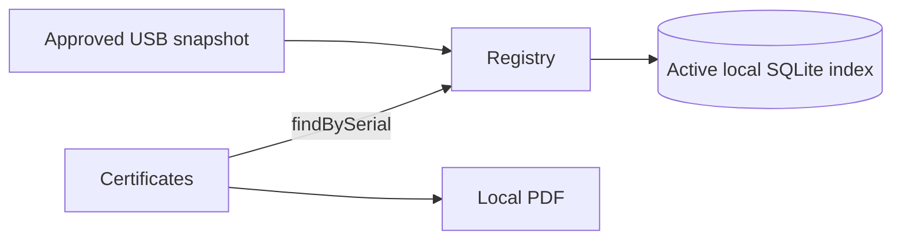

## Phase 1: HLD Review

```markdown
# GaugeDesk High-Level Design

## Problem

Six metrology kiosks help 35 technicians check calibration records before preparing inspection certificates. The equipment registry has approximately 90,000 serial numbers. Kiosks are inside an isolated production area, and technicians currently search a large spreadsheet copied in by USB.

## Approach

Accept signed registry snapshots from approved USB media. Each kiosk validates a snapshot and builds a local embedded SQLite index for serial-number lookups. Expose a stable serial-number lookup interface to a certificate component that produces local PDF files. Registry records are read-only on the kiosk; the central inventory team remains responsible for corrections and new snapshots.

## Target Users

- Technicians need fast, dependable serial-number results while preparing inspection certificates on kiosks in the production area.
- The central inventory team needs to distribute corrected registry data without granting kiosks authority to edit it.

## System Design

- Registry: `docs/intent/registry/registry-design.md`, with `docs/intent/registry/registry-specs.md`. Owns signed-snapshot validation, construction of the kiosk-local SQLite index, activation of a completed index, and lookup.
- Certificates: `docs/intent/certificates/certificates-design.md`, with `docs/intent/certificates/certificates-specs.md`. Uses the fixed registry result type and writes PDFs to a user-selected local directory.



## Tenets

- **Kiosk autonomy over centralized operation.** A kiosk must remain able to resolve its installed registry snapshot without a network dependency.
- **Stable component boundaries over storage coupling.** Certificate preparation relies on registry results, not registry storage or indexing details.

## Goals

- Resolve a serial number within 250 ms on a kiosk with 4 GB of RAM.
- Handle 90,000 records and snapshots up to 150 MB.
- Show the snapshot date on every lookup result and exported certificate.
- Let technicians produce certificates without installing extra software or fonts.

## Non-Goals

- Editing inventory records on kiosks.
- Live synchronization, remote access, or cloud services during kiosk operation.
- Reconciling certificate files across kiosks.

## Key Design Decisions

| Decision | Chosen | Alternatives Considered | Rationale |
|---|---|---|---|
| Registry lookup backend | A local embedded SQLite index built on each kiosk from a validated snapshot | On-site HTTPS directory; managed search service | Lookup remains available in the isolated production area and requires no network service, credentials, or runtime timeout handling. Per-kiosk index construction is accepted as part of snapshot import. |

## Success Metrics

- A lookup against the active index resolves within 250 ms on a kiosk with 4 GB of RAM.
- A kiosk accepts and indexes signed snapshots containing up to 90,000 records and 150 MB of source data.
- Every lookup result and exported certificate identifies the active snapshot date.
- Technicians can produce certificates without installing extra software or fonts.
```

The local SQLite selection is now recorded at the architecture level. Please approve this HLD revision, or identify changes, before I draft the registry LLD.