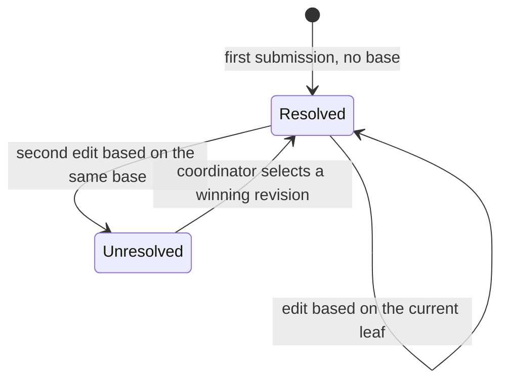

Coherence pre-flight and Phase 2 work are done. Now the Phase 2 STOP. Here is my response.

---

**Coherence pre-flight (resuming at Phase 2).** When I picked this up, the HLD, the record-store LLD, and the REC specs were mutually coherent — all three still described the concurrency choice as open. No drift to repair before starting. As part of landing your decision I made two coherence repairs to `docs/high-level-design.md`: dropped the now-false `concurrency choice open` state on the record-store row and changed "that node's unresolved choice" → "that node's revisioning contract." The HLD's architecture and tenets are unchanged (the HLD already delegates this mechanism to record-store), so no full Phase 1 re-review was triggered. I did **not** touch the REC specs, and did **not** open tablet-sync or review-export — both are separate stops below.

**Phase 2 output — finished `docs/intent/record-store/record-store-design.md` (in full):**

```markdown
---
parent: high-level-design
prefix: REC
---

# Record Store

## Context

This node owns visit persistence and the meaning of a current visit when independently edited copies arrive. A visit is identified by a client-generated UUID and refers to a catalog plot UUID (see site-catalog). Updates can arrive days after the state they were based on was fetched, because tablets collect observations offline. The server does not treat arrival order as evidence that one worker's observations are more authoritative.

Visits are structured records: observation date, observer list, species cover estimates, and notes. Two edits can be unrelated (correcting an observer name; adding a missing species) or scientifically related (revising a species identification together with its cover estimate). The record store does not infer these relationships from field names.

Tablet-sync and review-export consume this node's contract. They do not define concurrency semantics; the meaning of a current visit and of unresolved work is fixed here.

## Concurrency Policy: Whole-Visit Revisions

A visit is a sequence of immutable whole revisions. Each revision is a complete snapshot of the visit's fields — never a partial diff — together with a revision ID, the base revision ID it was derived from, the submitting worker's ID, the server receipt time, and the idempotency key that produced it. A visit's first revision has no base.

A submission names the base revision its author worked from. If that base is the visit's single current leaf revision, the new revision becomes the current revision and the visit stays resolved. If the base already has another child revision — a second worker edited the same base, or the base has since been superseded — the new revision is retained as a competing sibling and the visit becomes unresolved. Competing revisions are never combined field by field; each remains the intact visit its author submitted. Arrival order never resolves a conflict: concurrent children of one base revision are peers until a coordinator acts.



## Submission Envelope

A submission carries:

| Field | Meaning |
|-------|---------|
| visitId | client-generated UUID for the visit |
| baseRevisionId | revision ID the edit was derived from; absent for the first submission |
| visit | complete field set: plot UUID, observation date, observer list, species cover estimates, notes |
| authorId | authenticated submitting worker |
| idempotencyKey | client-generated key for safe retries |

Tablets retain the base revision ID, not a full base snapshot. The server validates field types and the plot reference before accepting a submission, then assigns the revision ID and server receipt time. The original payload is preserved separately from any resolved outcome. A retry with the same key and identical payload returns the original acceptance result without creating another revision; reuse of a key with a different payload is rejected.

## Current-State and History Retrieval

Current-state retrieval returns exactly one of:

- a single current revision (the visit is resolved), or
- an unresolved marker listing the competing revision IDs and their complete contents, so a reviewer can compare whole visits.

Submission-history retrieval returns the full revision tree: every original submission with its author, server receipt time, and base link. The path from any exported value back to a single worker's submission stays inspectable. Original revisions are retained; how long history is kept before compaction is an open question.

## Review Resolution

A coordinator resolves an unresolved visit by selecting one of the competing revisions as the current revision. The resolution records the coordinator's ID, the contributing submission IDs — both the selected and the non-selected competing revisions — and the outcome. Non-selected revisions are retained, never discarded. After resolution the visit has a single current revision and is resolved.

## Export Eligibility

The record store marks a visit export-eligible if and only if it has a single current revision and no unresolved review work. Unresolved visits are ineligible. The review/export side consumes this eligibility state and the unresolved marker; it does not decide what makes a visit resolved.

## Downstream Contract Consumers

- tablet-sync sizes its local storage around the submission envelope: it keeps the base revision ID of the last known current revision, sends complete visit snapshots, and surfaces pending competing revisions to field workers. It does not invent conflict semantics.
- review-export builds a revision comparison screen from the unresolved marker's competing revisions and holds export-ineligible visits out of the partner CSV. It does not decide what makes a visit resolved.

These are sibling-segment obligations, owned by their own nodes. This node fixes the contract they consume.

## Decisions & Alternatives

| Decision | Chosen | Alternatives Considered | Rationale |
|----------|--------|------------------------|-----------|
| Reconciling concurrent edits | Whole-visit revisions: competing complete revisions go to a coordinator | Field-aware three-way merge (auto-combine unrelated field edits, review overlaps) | A larger review queue is preferable to maintained merge rules that could combine scientifically related edits — for example a species identification and its cover estimate — without detecting the relationship. Whole-visit revisions keep each submitted visit intact and make every exported value traceable to one worker's submission. |
| Submission payload form | Complete visit snapshot plus base revision ID | Structured field-level changes plus a base snapshot | Whole-visit revisioning needs no field diffs; a complete snapshot is exactly the unit a coordinator compares and selects. It also bounds tablet state to one base revision ID. |

## Open Questions & Future Decisions

### Resolved
1. Concurrency policy: whole-visit revisions.

### Deferred
1. Whether a coordinator may author a new corrected revision instead of selecting among submitted competing revisions.
2. Revision-history retention and compaction policy as visit counts grow.

## References

- docs/high-level-design.md — project tenets and node responsibilities
- docs/intent/site-catalog/site-catalog-design.md — stable plot UUIDs retained in each original submission
```

**LLD-level edge-case probe — gaps in this LLD (generated in-context; I can hand it to a delegated zero-context reader for less-biased coverage if you'd prefer):** what happens when (1) a submission names a `baseRevisionId` that doesn't exist or belongs to another `visitId`; (2) two submissions with the same idempotency key arrive concurrently; (3) a worker bases an edit on a revision that *lost* a prior resolution; (4) a late submission on an older base arrives *after* a coordinator resolves the visit — reopen, new competing branch, or reject; (5) an idempotency key is reused with a different payload — what is the error shape; (6) one worker produces two competing revisions from one base; (7) a coordinator wants to author a brand-new corrected revision instead of selecting one submitted revision.

---

**STOP — Phase 2 boundary. I'm holding here. Rulings I need from you before any tests or code:**

1. **Decision doc.** This choice stays live for a cold reader — two credible options traded against review volume, implementation burden, whole-visit intent, and scientific-relatedness, with tablet-sync and review-export about to be sized around it. I've recorded it as a Decisions & Alternatives row. Do you want a full standalone decision doc (`docs/intent/record-store/decisions/`) as well, or is the row enough? I have **not** written one — your call.
2. **Tenet.** "Take a bigger review queue over merge rules that can combine scientifically related edits unnoticed" reads as a forward-looking lean (its opposite is defensible), not something the HLD's current four tenets state. Should I add it under `## Tenets`, or keep it only in the decision record? I have **not** added it.
3. **Probe triage.** For each of the seven gaps above: fix in the LLD now, or defer as an open question? I have **not** resolved any of them.
4. **Cross-segment cascade.** The choice creates obligations in tablet-sync (base revision IDs, complete snapshots, pending competing revisions) and review-export (revision comparison screen, holding unresolved visits out of the CSV). These are sibling segments — I'm pausing at the boundary and have **not** written those designs. Confirm the hold per "we'll do tablet sync and review/export after that"?
5. **Next phase.** `REC-004` still says "regardless of the concurrency policy's outcome," and the new revisioning contract (submission envelope, unresolved marker, resolution, export eligibility) has no spec coverage yet. That's the Phase 3 spec cascade within this segment. Do I have your explicit approval to proceed, and any numbered feedback on the LLD above?