The record-store design is complete. Phase 2 stop — presenting it for review before the EARS update (Phase 3).

**HLD refresh (mechanical consequence of your selection):** the record-store state cell now reads "Drafted" (concurrency choice no longer open), and the dependency paragraph now says record-store's whole-visit revision model determines submission metadata, review shape, and export eligibility — tablet-sync and review-export build on the contract defined there.

**The completed LLD** — `docs/intent/record-store/record-store-design.md`:

---

# Record Store

## Context

This node owns visit persistence and the meaning of a current visit when independently edited copies arrive. A visit is identified by a client-generated UUID and refers to a catalog plot UUID. Updates can arrive days after their starting state was fetched. The server must not treat arrival order as evidence that one worker's observations are more authoritative.

Tablet-sync and review-export are not yet designed. Both consume the contract defined here — the submission envelope, the current-state response, the unresolved-work representation, and the resolution operation — and link back to this node rather than inventing their own concurrency semantics.

## Architecture

The record store exposes submission, current-state retrieval, revision retrieval, unresolved-work enumeration, export-eligible enumeration, and resolution. Persistence retains every accepted submission with its author and server receipt time; no stored revision is ever overwritten or deleted.

A submission carries an idempotency key so a connection failure does not create another edit on retry.

A visit's scientific fields — observation date, observer list, species cover estimates, notes — are opaque to the store's concurrency behavior. A submission is one complete visit payload; the store never interprets or combines individual fields. Which field edits are scientifically related (a species-identification correction and the cover estimate that belongs with it, versus an observer-name fix and an added species) is not recoverable from field names, so it is decided by a coordinator, not by rules.

## Whole-Visit Revisions

Every accepted submission is stored as a **revision**: the complete visit payload exactly as submitted, with the author ID, server receipt time, a server-assigned revision ID, and the **base revision ID** — the revision the author had when preparing the edit. The first submission of a visit carries no base revision ID and becomes revision 1.

Each visit designates one **current** revision:

- A submission whose base revision is the visit's current revision is accepted as the new current revision (fast-forward).
- A submission whose base revision exists but is not current is stored as a **pending** revision, and the visit enters the **unresolved** state.

A visit is unresolved while any pending revision exists. Pending revisions are reviewed against whatever revision is current at review time; a later fast-forward changes the comparison but does not consume or clear pending work. Arrival order never discards or demotes a stored revision.

```mermaid
stateDiagram-v2
    [*] --> Resolved : first submission accepted (revision 1, current)
    Resolved --> Resolved : submission with base = current (fast-forward)
    Resolved --> Unresolved : submission with base ≠ current (stored as pending)
    Unresolved --> Unresolved : further submissions stored (current may fast-forward; pending persists)
    Unresolved --> Resolved : resolution settles every pending revision
```

## Submission Envelope

| Field | Content |
|---|---|
| visit ID | client-generated UUID |
| base revision ID | server-assigned revision ID the edit was prepared against; absent on the visit's first submission |
| payload | the complete visit: plot UUID, observation date, observer names, species cover entries (species and cover estimate), notes |
| idempotency key | client-generated |
| author | authenticated worker identity, taken from the session, never from the payload |

An accepted idempotency key with an identical payload returns the original acceptance result; reuse of an accepted key with a different payload is rejected. A rejected submission stores nothing and does not consume its key. An idempotency key is unique within the submitting author's submissions.

The acceptance result returns the assigned revision ID, whether that revision became current or is pending, and the visit's unresolved flag. An idempotent replay returns the original acceptance result verbatim, even after the visit's state has changed since.

Validation before acceptance, after the idempotency check: field types; plot UUID resolvable in the site catalog (archived plots remain valid references); base revision, when present, exists and belongs to the named visit; a base-less submission is valid only for a visit with no stored revisions. Every rejection identifies its reason — idempotency conflict, invalid field, unresolvable plot UUID, unknown or foreign base revision, or a base-less submission against a visit that already has revisions — so a tablet can distinguish conditions its worker can fix from transport failures.

## Current State and Unresolved Work

Retrieval of a visit returns its current revision (revision ID, payload, author, receipt time), an unresolved flag, and, when unresolved, each pending revision's ID, author, receipt time, and base revision ID, ordered by receipt time. Any revision's full payload is retrievable by revision ID (submission history).

For the review queue, the store enumerates unresolved visits with their pending revision sets, ordered by oldest pending receipt time.

For export, the store enumerates export-eligible visits — those with a current revision and no pending revisions — ordered by plot UUID.

## Resolution

A resolution is a coordinator act applying to a single visit that names:

- the new current revision — one of the pending revisions, a complete coordinator-authored payload, or the existing current revision (an explicit dismissal of the pending set), and
- the pending revisions this act settles.

A coordinator-authored payload may deliberately combine content from several revisions; under this policy that combination is always a named human decision, never an automatic merge. A coordinator-authored payload meets the same field validation as a submission, becomes a stored revision with a server-assigned revision ID and the superseded current as its base, and is thereafter an ordinary revision that later submissions can fast-forward against.

The store records the coordinator's identity and the contributing submission IDs with the outcome: the settled pending revisions plus the superseded current revision, whenever the new current differs from it. Pending revisions not named by the act remain pending and the visit stays unresolved. A resolution naming revisions that do not exist, belong to another visit, or are already settled is rejected, and nothing changes.

## Export Eligibility

The contract for review-export: a visit is export-eligible when it has a current revision and no pending revisions. Unresolved visits are held out of the export until resolved. Review-export renders the comparison between pending and current revisions from the retrieval shapes above.

## Decisions & Alternatives

| Decision | Chosen | Alternatives Considered | Rationale |
|----------|--------|--------------------------|-----------|
| Concurrency policy | Whole-visit revisions: concurrent edits produce competing complete revisions for a coordinator to resolve | Field-aware three-way merge (disjoint field changes combine automatically; overlaps go to review) | The store cannot infer which field edits are scientifically related from field names; automatic combination could join related edits — e.g. a revised species identification and the cover estimate belonging to the earlier identification — without anyone noticing. A larger review queue is accepted over maintaining merge rules, keeping the scientific judgment with the coordinators. |
| Revision granularity | One complete visit payload per revision | Field-level change records | The worker's visit is the unit of intent; whole payloads make comparison a whole-visit diff and preserve exactly what was submitted. |
| Conflict detection | Submitter names a base revision ID; mismatch against current at acceptance creates pending work | Payload diffing; server receipt timestamps | The base ID states what the author actually saw. Arrival order and timestamps carry no authority over whose observations win. |
| Resolution shape | Coordinator selects one revision or authors a combined payload; contributing submissions retained with the outcome | Select-one-only; rule-based combination | Manual combination is sometimes the right science, but here it is a recorded human decision with a named author, not an inferred one. |

## Open Questions & Future Decisions

### Resolved
1. ✅ Concurrency policy: whole-visit revisions (see Decisions & Alternatives).

### Deferred
1. Concurrent resolution: whether two coordinators resolving the same visit simultaneously need server-side serialization or a stale-state rejection on the second act.
2. Duplicate visits: two offline workers recording the same real-world visit produce different visit UUIDs; where duplicates get detected (likely at coordinator review) belongs to the tablet-sync/review-export designs.
3. Review-queue ordering beyond oldest-pending-first, if coordinators need site- or plot-based grouping.
4. Rejection audit: whether rejected submissions are recorded anywhere beyond the rejection response, for coordinators investigating lost data.
5. Coordinator corrections outside review: whether a coordinator can edit a fully resolved visit directly (not as part of resolving pending work).

## References

- docs/intent/site-catalog/site-catalog-design.md — plot UUID contract and archived-plot resolution
- docs/high-level-design.md — tenets: no silently discarded edit; inspectable path from submission to exported value

---

**Edge-case probe (delegated to a fresh reader given only the design doc).** It returned 10 gaps. I settled the mechanical ones directly in the draft above — rejection reasons named in the response; acceptance result carries revision ID + current/pending + unresolved flag; idempotent replay returns the original result verbatim; coordinator-authored resolutions become ordinary revisions (so later submissions can fast-forward against them); resolutions may keep the existing current (explicit dismissal of pending); invalid resolution acts rejected with no change; idempotency key scoped per author; pending and queue ordering; export-eligible enumeration. **Stances I'd like you to confirm or veto:**

1. **Fast-forward during unresolved state**: a submission based on the *current* revision still becomes current even while other revisions are pending — the pending work stays and is compared against the new current at review time.
2. **Base-less submission against an existing visit is rejected** (the tablet must name its base) rather than treated as a competing revision.

**Genuinely open — triage these (fix in the LLD now vs. keep deferred):** the five Deferred items above. My suggestion: keep all five deferred for now — none blocks the contract, and #2 (duplicate visits) and #3 (queue ordering) belong to the downstream designs anyway.

**Decision doc offer (once):** the whole-visit-vs-merge choice stays live for a cold reader — two credible options traded on review workload, implementation burden, and scientific safety, with two nodes about to be sized around it. Want it memorialized as a full decision doc at `docs/intent/record-store/decisions/`, or is the Decisions & Alternatives row enough? The row exists either way.

On your approval I'll proceed to Phase 3: updating `record-store-specs.md` — new specs for the revision model, envelope validation, unresolved-work representation, resolution, and export eligibility, alongside the existing REC-001–006, with a consistency report. Numbered feedback welcome on anything above.